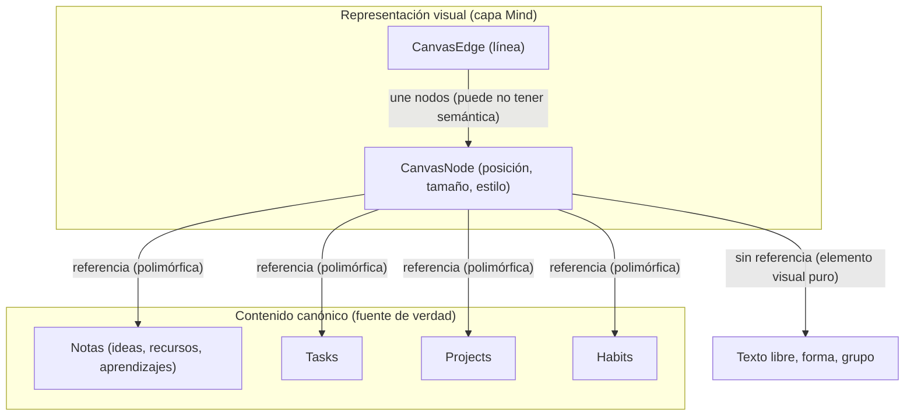
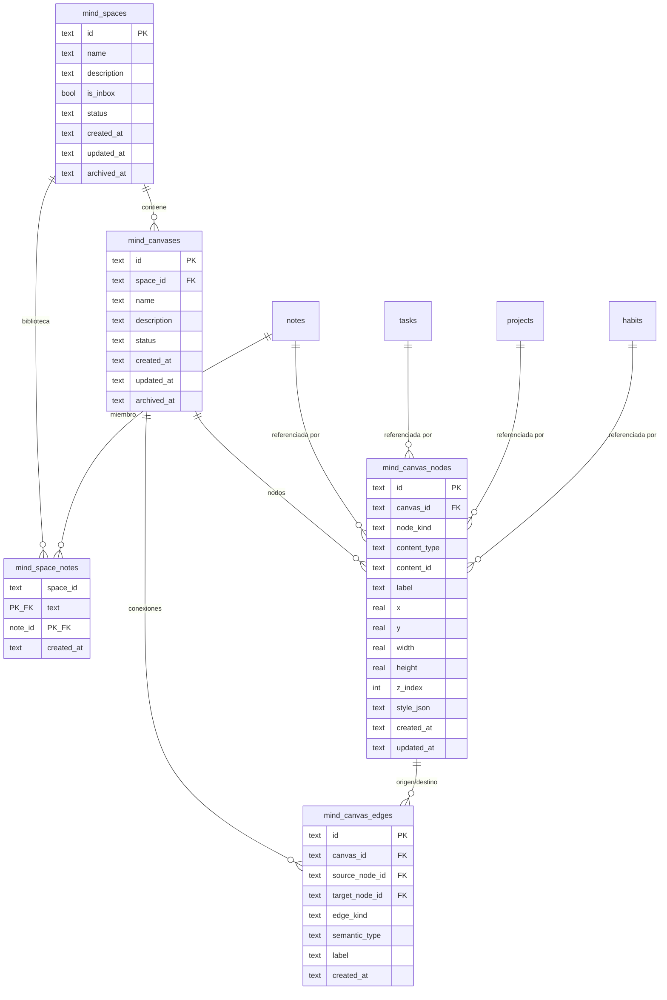

# Mind — Plan de implementación (borrador)

**Proyecto:** LifeOS
**Tarea:** MIND-001 — Diseño funcional y técnico de Mind
**Estado:** PLANNING — NO AUTORIZA IMPLEMENTACIÓN
**Versión:** 0.1 (borrador para aprobación del PO)
**Fecha:** 21 de noviembre de 2026
**Rama:** planning/mind-001
**Relacionado con:** `PRODUCT_MODEL.md`, `UX_DIRECTION.md`, `AI_AGENT_MODEL.md`, `METRICS_CATALOG.md`, `ARCHITECTURE.md`, `DATABASE.md`, `SECURITY.md`, `ROADMAP.md`, `AGENTS.md`
**Referencias leídas (solo lectura, NO fusionadas):** `origin/product/mind-foundation` → `docs/product/MIND_PRODUCT_MODEL.md`, `docs/product/ORBES_MODEL.md`, `docs/factory/work/MIND-001/DESIGN_TASK.md`

> Este documento es una **propuesta de diseño** para discusión y aprobación del Product Owner. **No autoriza código, migraciones, endpoints ni cambios al runtime.** Distingue explícitamente HECHOS, PROPUESTAS, SUPUESTOS y PREGUNTAS.

## Convención de estados en este documento

- **HECHO:** verificado en el repositorio o en documentos aprobados.
- **PROPUESTA:** diseño propuesto, pendiente de aprobación del PO.
- **SUPUESTO:** asumido sin confirmación explícita.
- **PREGUNTA:** requiere decisión del PO.

---

## A. Auditoría del estado actual

### A.1 Qué existe realmente en LifeOS (HECHOS)

| Aspecto | Estado verificado |
|---|---|
| **Rama de trabajo** | `product/lifeos-evolution` (HEAD `975bf80`). El worktree `LifeOS-mind-planning` opera sobre `planning/mind-001`, alineado a `origin/product/lifeos-evolution`. |
| **Módulos funcionales** | Home, Tasks, Projects, Notes, Habits, Dashboard/Widgets, Analytics básico, Settings. **No existe módulo Mind.** |
| **Stack** | FastAPI + SQLAlchemy 2.x síncrono + SQLite + Alembic; frontend HTML/CSS/JS nativo (módulos ES, routing por hash en `frontend/assets/js/app.js`); API bajo `/api/v1`; servidor `127.0.0.1:8000`; pruebas pytest + HTTPX; Ruff. |
| **Patrón por módulo** | `models.py` → `schemas.py` → `repository.py` → `service.py` → `app/api/v1/<modulo>.py`. Los cambios de dominio y el evento (`activity_events`) se confirman en la misma transacción (`get_db`). |
| **Identidad y tiempo** | UUIDv4 como texto (36 chars), timestamps UTC ISO 8601, vencimientos `YYYY-MM-DD` local. |
| **Integridad** | `PRAGMA foreign_keys = ON` por conexión. `tasks.project_id` y `habit_entries.habit_id`: `ON DELETE RESTRICT`. Vínculos nota↔proyecto/tarea/etiqueta: `ON DELETE CASCADE` solo en la fila de vínculo, nunca en el contenido. Archivado preferido a eliminación física. |
| **Contenido canónico existente** | `notes` (título + texto plano + timestamps + etiquetas + vínculos). Búsqueda simple por coincidencia parcial en título/contenido (sin FTS). |
| **Entidades LifeOS reutilizables** | `tasks`, `projects`, `habits` con sus servicios, repositorios y rutas API propias. |
| **Exportación / backup** | `/export` JSON versionado (incluye todas las entidades). Backup SQLite vía API `sqlite3.Connection.backup`. Restauración documentada y probada con base temporal. |
| **Documentos de producto actuales** | `docs/product/`: `PRODUCT_MODEL.md`, `UX_DIRECTION.md`, `AI_AGENT_MODEL.md`, `METRICS_CATALOG.md`. **Ninguno cubre Mind.** |
| **Cola de trabajo** | `docs/factory/work/WORK_QUEUE.md`: Fase 9 items READY en REVIEW; sección "Diseño futuro — no autoriza código" con `PRJ-PLAN-001`, `PRJ-WORKSPACE-001`, `ANALYTICS-001` en PLANNING. **No hay entrada de Mind.** |
| **Referencias de Mind** | Viven solo en `origin/product/mind-foundation`: `MIND_PRODUCT_MODEL.md`, `ORBES_MODEL.md`, `MIND-001/DESIGN_TASK.md`. Leídos con `git show` (sin merge, sin copiar como gobernanza). |

### A.2 Qué puede reutilizarse (PROPUESTA de reutilización)

1. **Patrón de módulo** (models/schemas/repository/service/rutas) → nuevo módulo `mind`.
2. **`notes`** → capa canónica de conocimiento de Mind (ideas, recursos y aprendizajes se representan como notas en el MVP; ver ADR-2).
3. **`tasks`, `projects`, `habits`** → entidades LifeOS referenciables desde el Canvas mediante sus servicios originales (nunca duplicadas).
4. **`activity_events`** → eventos de dominio de Mind (`space.created`, `canvas.node_moved`, etc.) en la misma transacción, con metadatos mínimos.
5. **`/export` JSON y backup SQLite** → extensión natural para incluir las tablas nuevas.
6. **Componentes frontend** (`showToast`, `showConfirm`, tokens CSS, clases `card`, `btn`, `modal`, `empty-state`) → UI de Mind sin dependencias nuevas.
7. **Búsqueda simple de Notes** → base de la búsqueda de conocimiento de Mind.

### A.3 Qué falta

- Todo el módulo Mind: tablas, modelos, servicios, rutas, frontend y pruebas.
- Diseño de contenido canónico vs. representación visual (este documento).
- Definición de Inbox, Spaces, Canvas, Knowledge, Insights y Orbes en la cola de trabajo.
- QA visual de Mind (no existe interfaz aún).

### A.4 Contradicciones documentales detectadas

1. **Rama de trabajo**: `AGENTS.md` indica `product/lifeos-evolution` por defecto; el encargo MIND-001 ordena `planning/mind-001`. **Asumido:** el encargo del PO prevalece para esta tarea. (SUPUESTO)
2. **Fase 9 vs. PLANNING**: `ROADMAP.md` marca Fase 9 como "autorizada"; `AGENTS.md` §9 dice "PLANNING autoriza diseño solamente". MIND-001 es PLANNING → **coherente**: solo diseño.
3. **Mind en Visión/Requisitos**: `VISION.md` §32 y `REQUIREMENTS.md` §6 dejan Mind como futuro/fuera del MVP 0.1 y 0.2. **Coherente** con diseñar Mind sin tocar el runtime de Fase 9.
4. **`ARCHITECTURE.md` §5**: "No se crearán módulos vacíos ni tablas preparatorias para Mind". **Apoya** no añadir tablas de Mind aún; el modelo de datos de este documento es **propuesta**, no esquema aprobado.
5. **Documentos de Mind fuera de la rama actual**: `MIND_PRODUCT_MODEL.md` y `ORBES_MODEL.md` solo existen en `origin/product/mind-foundation`; **no son gobernanza vigente** en `product/lifeos-evolution`.
6. **`contexto_lifeos.txt`**: archivo sin trackear con codificación rota, copia desactualizada de gobernanza. **No es fuente autoritativa**; se preserva sin usar.

---

## B. Modelo de producto

### B.1 Principio rector (HECHO, de `MIND_PRODUCT_MODEL.md`)

> El usuario piensa; Mind ayuda a explorar y organizar; los Orbes colaboran; el usuario decide.

Mind no es un pizarrón infinito, ni un gestor de tareas disfrazado, ni un chat que reemplace el conocimiento estructurado.

### B.2 Definiciones de módulo

| Módulo | Responsabilidad | Límite / no es |
|---|---|---|
| **Inbox** | Captura transversal sin fricción. Una captura puede permanecer sin clasificar. | No es un espacio de trabajo; es una zona de aterrizaje. |
| **Spaces** | Contextos flexibles (Personal, Research, Learning). Agrupan Canvases y una biblioteca de conocimiento. No aíslan ni duplican contenido. | No es una carpeta rígida ni una jerarquía forzada. |
| **Canvas** | Lienzo visual libre con estructura opcional. Espacio de exploración. | No es el único contenido de Mind; no es un diagrama obligatorio. |
| **Knowledge** | Notas, ideas, conceptos, fuentes y aprendizajes con identidad propia. Contenido canónico. | No es copia de nada; es la fuente de verdad del conocimiento. |
| **Insights** | Hallazgos y conexiones descubiertas sobre el conocimiento. | **No reemplaza Analytics** (métricas longitudinales del desempeño personal). |
| **Orbes** | Sesiones contextuales que analizan y proponen (etapa posterior, ver §H). | No son modelos ni proveedores ni agentes autónomos. |

### B.3 Relaciones conceptuales

- Mind tiene una **Inbox transversal** para capturas pendientes.
- El usuario crea y abre varios **Spaces**.
- Cada **Space** contiene uno o más **Canvases** y una biblioteca de conocimiento (**Knowledge**).
- Un mismo **contenido** puede referenciarse desde varios **Canvases** sin duplicarse.
- La **captura rápida** está disponible desde cualquier contexto.
- Crear contenido dentro de un **Canvas** puede asignarle ese contexto inicial sin obligarlo a pasar por Inbox.

### B.4 Capas de contenido (separación obligatoria)

Reglas (HECHO, de `MIND_PRODUCT_MODEL.md`):
- Mover un nodo cambia solo su posición.
- Quitar un nodo de un Canvas elimina la representación, **no** el contenido original.
- Eliminar contenido canónico requiere confirmación y afecta sus referencias.
- Editar contenido actualiza todas sus representaciones.
- Una nota puede aparecer en varios canvases con posiciones independientes.
- Los elementos puramente visuales (texto libre, forma, grupo) **no** se convierten en entidades de dominio.

### B.5 Creación de elementos

El usuario puede elegir entre:
- **Contenido:** idea, nota, recurso. (MVP: todos se crean como `notes`; ver ADR-2.)
- **Entidades LifeOS:** objetivo, proyecto, tarea, hábito. Se crean mediante sus módulos/servicios canónicos, nunca con una segunda implementación paralela.
- **Elementos visuales:** texto, forma, grupo.

### B.6 Relaciones semánticas vs. conexiones visuales (PROPUESTA)

- **Conexión visual:** línea entre nodos en un Canvas, sin significado formal. Existe en el MVP.
- **Relación semántica:** significado entre contenidos canónicos (relacionado con, parte de, depende de, contribuye a, evidencia de, contradice, desarrolla). Es **independiente de posiciones** y puede representarse en varios Canvases. **Diferido a post-MVP** (ver ADR-4); el modelo de datos la contempla pero el MVP solo crea conexiones visuales.

### B.7 Búsqueda

- Búsqueda global sobre contenido de Mind y, progresivamente, entidades vinculadas de LifeOS.
- Búsqueda contextual dentro del Space/Canvas actual, con filtros.
- Un resultado puede abrir el contenido original, navegar hasta una representación en un Canvas o agregar una referencia a otro Canvas sin duplicar el contenido.

### B.8 Límites entre Mind y Analytics (HECHO, de `MIND_PRODUCT_MODEL.md`)

Mind puede analizar contenido y datos dentro de un contexto y generar visualizaciones puntuales. Analytics mantiene el catálogo oficial, las fórmulas canónicas y el historial. Un artefacto de un Orbe debe reutilizar métricas oficiales cuando existan y declarar cualquier cálculo ad hoc. **Prohibido inventar series, salud o progreso.**

---

## C. Experiencia de usuario

### C.1 Flujos principales

Cada flujo indica pasos, estados y consideraciones responsive/accesibilidad. Las vistas reutilizan `UX_DIRECTION.md` (jerarquía, densidad útil, acción contextual, captura rápida, consistencia, responsive real, accesibilidad, claridad analítica).

#### C.1.1 Capturar (Inbox)

1. Usuario activa **Captura rápida** (botón global en Home o desde cualquier vista de Mind).
2. Campo de texto único (título opcional, contenido obligatorio). Atajo: `Ctrl/Cmd + Enter` guarda.
3. Al guardar, se crea una `note` y se asocia al **Space Inbox** (reservado). Muestra `toast` de éxito.
4. La captura aparece en la lista del Inbox; el usuario puede seguir capturando sin clasificar.
5. **Estados:** carga, vacío ("Sin capturas"), error (reintentar), éxito.

#### C.1.2 Organizar (clasificar una captura)

1. Desde Inbox, el usuario abre una captura.
2. Elige: **mover a un Space** (biblioteca), **añadir a un Canvas** (como nodo), o **dejar en Inbox**.
3. Mover a Space actualiza la membresía `space_notes`. Añadir a Canvas crea un `canvas_node` referenciando la nota.
4. La captura deja de estar "pendiente" cuando sale del Inbox.

#### C.1.3 Crear un Space

1. Vista **Mind → Spaces** → botón **Nuevo Space**.
2. Campos: nombre (obligatorio), descripción (opcional).
3. Al crear, se genera el **Space Inbox** si no existe (reservado, no editable como nombre).
4. Estado vacío: "Crea tu primer Space para organizar tus Canvases y conocimiento."

#### C.1.4 Crear un Canvas

1. Dentro de un Space → **Nuevo Canvas**.
2. Campos: nombre (obligatorio), descripción (opcional).
3. Al crear, se abre el lienzo vacío con barra de herramientas (Añadir elemento, Conectar, Zoom, Ajustar, Guardar).

#### C.1.5 Crear elementos en el Canvas

1. Barra de herramientas → **Añadir** → submenú: Contenido (nota existente / nueva idea), Entidad LifeOS (tarea/proyecto/hábito), Elemento visual (texto, forma).
2. **Nota existente:** buscador inline → al elegir, se crea un `canvas_node` que referencia la nota (no la copia).
3. **Nueva idea:** campo de texto → se crea una `note` y un `canvas_node` que la referencia.
4. **Entidad LifeOS:** selector → se referencia `task`/`project`/`habit` vía sus IDs.
5. **Elemento visual:** texto libre o forma → `canvas_node` sin referencia de contenido.
6. El nodo aparece en el punto de inserción; el usuario lo arrastra a su posición.

#### C.1.6 Conectar

1. Modo **Conectar** en la barra de herramientas (o arrastrar desde un manejador del nodo).
2. Usuario arrastra de un nodo origen a un nodo destino → se crea `canvas_edge` (conexión visual).
3. En MVP, la conexión es visual (sin semántica). Un clic en la línea permite etiquetarla opcionalmente.
4. **Estados:** previsualización mientras se arrastra, error si origen = destino.

#### C.1.7 Buscar

1. Buscador en la vista de Mind (global) o en el Space/Canvas (contextual).
2. Resultados muestran tipo (nota, tarea, etc.), título y preview.
3. Acciones: **Abrir** (contenido original), **Ir al Canvas** (navega a la representación), **Añadir a Canvas** (referencia sin duplicar).

#### C.1.8 Reutilizar contenido

1. Desde un nodo existente o desde Knowledge → **Añadir a otro Canvas**.
2. Se crea un nuevo `canvas_node` en el Canvas destino apuntando al **mismo** `content_id`.
3. Editar la nota desde cualquiera de sus nodos actualiza todas las representaciones (por referencia).

#### C.1.9 Editar

1. Doble clic (o botón **Editar**) sobre un nodo de contenido → abre el editor de la nota (o detalle de la entidad LifeOS).
2. Guardar → actualiza el contenido canónico; todos los nodos que lo referencian se refrescan.
3. Editar un elemento visual (texto libre) → actualiza solo su `label`.

#### C.1.10 Quitar (de un Canvas)

1. Seleccionar nodo → **Quitar del Canvas** (o `Delete`).
2. Se elimina el `canvas_node` y sus `canvas_edge` asociados.
3. **El contenido canónico NO se elimina.** Toast: "Nodo quitado del Canvas. El contenido se conserva en Knowledge."

#### C.1.11 Eliminar (contenido canónico)

1. Desde Knowledge o desde el editor de una nota → **Eliminar**.
2. `showConfirm` explícito (peligro): "Eliminar la nota X. Se quitará de todos los Canvases donde aparezca. ¿Continuar?"
3. Al confirmar: se elimina la `note` y **todos** sus `canvas_nodes` (y `canvas_edge` que los unan) en cualquier Canvas.
4. Para entidades LifeOS: se aplican sus políticas existentes (p. ej., no eliminar proyecto con tareas).

### C.2 Responsive, accesibilidad y teclado

| Escritorio (≥1024 px) | Tablet (768–1023 px) | Móvil (<768 px) |
|---|---|---|
| Sidebar Mind con Spaces/Canvases. Lienzo grande con paneles laterales colapsables (Knowledge, detalle). | Lienzo a pantalla completa; paneles como drawers superpuestos. | Lienzo a pantalla completa; barra de herramientas fija inferior. **Gestos:** pinch-zoom y pan táctil; selección por toque largo. Lista de nodos alternativa al lienzo para navegación por teclado/accesibilidad. |

- **Teclado:** navegación completa del lienzo con flechas (mover nodo seleccionado), `Tab` entre nodos, `Enter` editar, `Delete` quitar, `Esc` cancelar. Atajos documentados y visibles.
- **Accesibilidad:** contraste AA (reutilizar tokens de `vars.css`), foco visible en nodos, ARIA roles en lienzo (`role="application"` o lista de nodos accesible), estados no comunicados solo por color, alternativa textual a las conexiones (lista de relaciones del Canvas).
- **Estados obligatorios:** carga, vacío, error, éxito, selección/foco, confirmación de acciones destructivas (consistente con `showConfirm`).

---

## D. Modelo de datos

### D.1 Principios

- **No duplicar entidades de LifeOS.** El contenido canónico de Mind reutiliza `notes`, `tasks`, `projects`, `habits`.
- **Capa visual independiente.** `canvas_node` y `canvas_edge` son representación, no contenido.
- **Justificación por tabla.** Cada tabla nueva se justifica; ninguna es "preparatoria".
- **Convenciones vigentes:** UUIDv4 texto, timestamps UTC, `PRAGMA foreign_keys ON`, eventos en la misma transacción, archivado preferido.

### D.2 Tablas propuestas (PROPUESTA — requieren aprobación)

| Tabla | Propósito | Justificación |
|---|---|---|
| `mind_spaces` | Contexto que agrupa Canvases y biblioteca de conocimiento. | Requerido por "Spaces" (producto). Sin él no hay dónde colocar Canvases. |
| `mind_canvases` | Lienzo visual dentro de un Space. | Requerido por "un Space contiene varios Canvases". |
| `mind_space_notes` | Membresía de una nota en la biblioteca de un Space (Inbox o real). | Requerido por "Inbox" (captura sin clasificar) y "biblioteca de conocimiento" por Space. |
| `mind_canvas_nodes` | Representación visual de un contenido (o elemento visual puro) con posición/tamaño/estilo. | Requerido por "capa de representación visual" y "mover/quitar nodo sin eliminar contenido". |
| `mind_canvas_edges` | Línea visual entre dos nodos de un Canvas (conexión). | Requerido por "conectar" y "una línea visual puede no tener semántica". |
| `mind_content_relations` | **Post-MVP:** relación semántica canónica entre contenidos (significado). | Diseñada ahora, NO construida en el MVP. Justifica "relaciones semánticas independientes de posiciones y representables en varios Canvases" (ADR-4). |

### D.3 Definición lógica de tablas

#### `mind_spaces`
| Campo | Tipo | Regla |
|---|---|---|
| `id` | TEXT | PK UUIDv4. |
| `name` | TEXT | Obligatorio, no vacío. |
| `description` | TEXT | Opcional. |
| `is_inbox` | INTEGER/BOOLEAN | Default `false`; `true` solo en el Space Inbox reservado. |
| `status` | TEXT | `active` o `archived`. |
| `created_at`, `updated_at` | TEXT | UTC obligatorios. |
| `archived_at` | TEXT | Nullable. |

El **Space Inbox** es reservado (`is_inbox = true`); existe al menos uno por instalación (se crea bajo demanda).

#### `mind_canvases`
| Campo | Tipo | Regla |
|---|---|---|
| `id` | TEXT | PK UUIDv4. |
| `space_id` | TEXT | FK a `mind_spaces.id`, `ON DELETE RESTRICT`. |
| `name` | TEXT | Obligatorio, no vacío. |
| `description` | TEXT | Opcional. |
| `status` | TEXT | `active` o `archived`. |
| `created_at`, `updated_at` | TEXT | UTC obligatorios. |
| `archived_at` | TEXT | Nullable. |

No se elimina físicamente un Canvas con nodos (archivar preferido); si está vacío, puede eliminarse con confirmación.

#### `mind_space_notes`
| Campo | Tipo | Regla |
|---|---|---|
| `space_id` | TEXT | FK a `mind_spaces.id`, `ON DELETE CASCADE`, PK compuesta. |
| `note_id` | TEXT | FK a `notes.id`, `ON DELETE CASCADE`, PK compuesta. |
| `created_at` | TEXT | UTC obligatorio. |

PK compuesta (`space_id`, `note_id`) evita duplicados. Eliminar un Space o una Nota elimina solo la fila de membresía; nunca el contenido de la otra parte.

#### `mind_canvas_nodes`
| Campo | Tipo | Regla |
|---|---|---|
| `id` | TEXT | PK UUIDv4. |
| `canvas_id` | TEXT | FK a `mind_canvases.id`, `ON DELETE CASCADE`. |
| `node_kind` | TEXT | `content`, `text`, `shape` o `group`. |
| `content_type` | TEXT | Nullable; `note`, `task`, `project`, `habit`. Solo cuando `node_kind = content`. |
| `content_id` | TEXT | Nullable; referencia polimórfica (sin FK convencional). Solo cuando `node_kind = content`. |
| `label` | TEXT | Nullable; texto libre para `text`/`shape`, o display override opcional para `content`. |
| `x`, `y` | REAL | Posición en el lienzo. |
| `width`, `height` | REAL | Nullable; tamaño. |
| `z_index` | INTEGER | Orden de apilamiento. |
| `style_json` | TEXT | Nullable; estilo validado (color, forma). |
| `created_at`, `updated_at` | TEXT | UTC obligatorios. |

**Integridad:** cuando `node_kind = content`, `content_type` y `content_id` deben estar ambos presentes; cuando es visual (`text`/`shape`/`group`), ambos `NULL`. Validación en backend + `CHECK` lógico.

#### `mind_canvas_edges`
| Campo | Tipo | Regla |
|---|---|---|
| `id` | TEXT | PK UUIDv4. |
| `canvas_id` | TEXT | FK a `mind_canvases.id`, `ON DELETE CASCADE`. |
| `source_node_id` | TEXT | FK a `mind_canvas_nodes.id`, `ON DELETE CASCADE`. |
| `target_node_id` | TEXT | FK a `mind_canvas_nodes.id`, `ON DELETE CASCADE`. |
| `edge_kind` | TEXT | `visual` (MVP) o `semantic` (post-MVP). |
| `semantic_type` | TEXT | Nullable; solo cuando `edge_kind = semantic`. |
| `label` | TEXT | Nullable; etiqueta visual opcional. |
| `created_at` | TEXT | UTC obligatorio. |

Restricción: `source_node_id ≠ target_node_id`. En el MVP, `edge_kind` solo toma `visual`.

#### `mind_content_relations` (post-MVP, NO construida ahora)
| Campo | Tipo | Regla |
|---|---|---|
| `id` | TEXT | PK UUIDv4. |
| `source_type`, `source_id` | TEXT | Referencia polimórfica al contenido origen. |
| `target_type`, `target_id` | TEXT | Referencia polimórfica al contenido destino. |
| `semantic_type` | TEXT | `related`, `part_of`, `depends_on`, `contributes_to`, `evidence_for`, `contradicts`, `develops`. |
| `created_at` | TEXT | UTC obligatorio. |

PK/UNIQUE (`source_type`,`source_id`,`target_type`,`target_id`,`semantic_type`). Esta relación es **canónica e independiente de Canvases**; un `canvas_edge` puede referenciarla (`relation_id`) para visualizarla en uno o varios Canvases sin duplicarla.

### D.4 ERD (Mermaid)

### D.5 Resolución de casos específicos (HECHOS de diseño / PROPUESTAS)

#### D.5.1 Contenido canónico vs. nodos visuales
- **Canónico:** `notes`, `tasks`, `projects`, `habits` (existen; Mind no los duplica).
- **Visual:** `mind_canvas_nodes` (posición, tamaño, estilo) + `mind_canvas_edges` (línea). El nodo **nunca** copia el título ni el cuerpo del contenido; solo lo referencia (`content_type` + `content_id`) o es un elemento visual puro.

#### D.5.2 Referencias polimórficas
- `mind_canvas_nodes.content_type` + `content_id` referencian `note`/`task`/`project`/`habit`.
- **No hay FK convencional** (polimorfismo). Validación en backend al crear/actualizar: el `content_id` debe existir en la tabla indicada. Consistente con el patrón ya usado por `activity_events` (`entity_type` + `entity_id`).
- **Trade-off aceptado (ADR-1):** se pierde integridad FK en BD a cambio de flexibilidad; la validación de aplicación + pruebas cubren los casos.

#### D.5.3 Elementos visuales sin contenido canónico
- `node_kind ∈ {text, shape, group}` con `content_type`/`content_id` en `NULL`.
- `label` guarda el texto libre; `style_json` el estilo. **No se crea fila en `notes`.** Son solo presentación.

#### D.5.4 Relaciones semánticas vs. conexiones visuales
- **MVP:** solo `canvas_edge.edge_kind = visual` (línea entre nodos de un Canvas). Sin semántica.
- **Post-MVP:** `mind_content_relations` guarda el significado entre contenidos canónicos (independiente de Canvases); un `canvas_edge` puede referenciarla para mostrarla en varios Canvases. Así una relación semántica **no se duplica** al aparecer en varios Canvases.

#### D.5.5 Eliminación y referencias rotas
- **Quitar nodo de Canvas:** borra `canvas_node` y sus `canvas_edge`; **no** toca el contenido canónico.
- **Eliminar contenido canónico (nota):** confirmación explícita; borra la `note` → sus `mind_space_notes` y **todos** sus `canvas_nodes` (y `canvas_edge` que los unan) en cualquier Canvas. Coherente con "eliminar contenido afecta sus referencias".
- **Eliminar tarea/proyecto/hábito:** se aplican las políticas existentes (`RESTRICT`/archivado). Los `canvas_nodes` que los referencien se eliminan en cascada lógica (misma transacción) o quedan como referencia rota marcada; **propuesta:** eliminar los nodos al confirmar la baja de la entidad, consistente con notas.
- **Referencias huérfanas:** evitadas por validación en backend y por las políticas de borrado en cascada.

#### D.5.6 Reutilización en múltiples Canvases
- Varios `mind_canvas_nodes` (de distintos `canvas_id`) pueden compartir el mismo `content_type` + `content_id`.
- Editar la nota actualiza todas las representaciones (por referencia). **No hay copias.**

#### D.5.7 Exportación, backup y restauración
- **Exportación JSON:** añadir `mind_spaces`, `mind_canvases`, `mind_space_notes`, `mind_canvas_nodes`, `mind_canvas_edges` a `/export` (y `mind_content_relations` cuando exista). Conservar IDs y relaciones; formato independiente del ORM (convención existente).
- **Backup SQLite:** cubre las tablas nuevas automáticamente (backup completo de la BD). Sin cambios.
- **Restauración:** procedimiento existente (integrity_check + reemplazo controlado). Probar con base temporal incluyendo datos de Mind.

### D.6 Índices propuestos

- `mind_canvases(space_id)`, `mind_canvases(status)`;
- `mind_space_notes(note_id)`;
- `mind_canvas_nodes(canvas_id)`, `mind_canvas_nodes(content_type, content_id)`;
- `mind_canvas_edges(canvas_id)`, `mind_canvas_edges(source_node_id)`, `mind_canvas_edges(target_node_id)`.

### D.7 Eventos de actividad (PROPUESTA)

En `activity_events`, con metadatos mínimos (sin cuerpos de notas):
- `mind.space.created`, `mind.space.updated`, `mind.space.archived`;
- `mind.canvas.created`, `mind.canvas.updated`, `mind.canvas.archived`;
- `mind.canvas.node_added`, `mind.canvas.node_moved`, `mind.canvas.node_removed`;
- `mind.canvas.edge_added`, `mind.canvas.edge_removed`;
- `mind.inbox.captured`.

---

## E. Arquitectura

### E.1 Responsabilidades por capa

| Capa | Responsabilidad en Mind |
|---|---|
| **Frontend** (`frontend/assets/js/mind.js` + `mind_canvas.js`) | Navegación, lienzo (render, drag, zoom/pan), formularios, estados, accesibilidad. Consume `/api/v1`. No calcula reglas críticas ni persiste por su cuenta. |
| **API** (`app/api/v1/mind.py`) | Rutas, esquemas, validación, códigos HTTP. Llama a servicios. Sin lógica de dominio extensa. |
| **Servicio** (`app/modules/mind/service.py`) | Casos de uso (crear Space/Canvas, añadir nodo, mover, conectar, clasificar Inbox). Valida relaciones y políticas de borrado. Registra eventos en la misma transacción. |
| **Repositorio** (`app/modules/mind/repository.py`) | Consultas SQLAlchemy: nodos por Canvas, membresías, referencias polimórficas. |
| **Persistencia** | Migración Alembic nueva (aprobada por PO). `PRAGMA foreign_keys ON`. |

### E.2 Contrato API orientativo (PROPUESTA)

Prefijo `/api/v1/mind`:

| Recurso | Operaciones |
|---|---|
| `/mind/spaces` | GET, POST; `/mind/spaces/{id}` GET, PATCH, DELETE (restringido); archivar/restaurar. |
| `/mind/spaces/{id}/canvases` | GET, POST. |
| `/mind/canvases/{id}` | GET (nodos + edges), PATCH, DELETE (restringido); archivar/restaurar. |
| `/mind/canvases/{id}/nodes` | GET, POST; `/mind/canvases/{id}/nodes/{nid}` GET, PATCH (posición/estilo), DELETE (quitar del Canvas). |
| `/mind/canvases/{id}/edges` | GET, POST; `/mind/canvases/{id}/edges/{eid}` PATCH, DELETE. |
| `/mind/inbox` | GET (capturas pendientes), POST (captura rápida → crea nota + membresía Inbox). |
| `/mind/spaces/{id}/notes` | GET (biblioteca), POST (añadir nota existente), DELETE (quitar membresía). |
| `/mind/search` | GET con `q` y filtros (space_id, canvas_id, tipo). |

Los nombres exactos se ajustan al implementar sin cambiar el comportamiento requerido.

### E.3 Rendimiento, persistencia y navegación de Canvases grandes (PROPUESTA)

| Tema | Estrategia MVP | Evolución post-MVP |
|---|---|---|
| **Recuperación** | `GET /mind/canvases/{id}` devuelve todos los nodos + edges. Suficiente para cientos de nodos. | Paginación/viewport; límite duro (p. ej., 2000 nodos) con aviso. |
| **Renderizado** | Nodos como `div` absolutamente posicionados en contenedor con `overflow:auto`. Conexiones como líneas SVG superpuestas (mismo contenedor, `pointer-events:none`). | Virtualización (render solo nodos visibles); índice espacial (grid/quadtree nativo, sin librería). |
| **Zoom / pan** | `transform: scale/translate` en contenedor. Pinch-zoom táctil. | Similar; optimizar repaint con `will-change`. |
| **Guardado** | **Autosave incremental:** al soltar un nodo (drag end), `PATCH` solo ese nodo (posición). Debounce para cambios rápidos. | Batch de posiciones; guardado por lote si hay muchos movimientos. |
| **Carga inicial** | Una request con nodos + edges. | Carga por zonas; caché local de posiciones. |
| **Accesibilidad grande** | Lista de nodos accesible (alternativa al lienzo) para navegar por teclado. | Igual + búsqueda dentro del Canvas. |

### E.4 Decisiones técnicas clave

- **Sin librerías de canvas:** render con DOM nativo + SVG para líneas. No introducir fabric.js, Konva, D3 ni similar sin aprobación explícita (ADR-5).
- **Sin WebSocket ni cola:** guardado por request HTTP (consistente con el stack síncrono actual).
- **Sin FTS:** búsqueda simple por coincidencia parcial, como Notes (suficiente para MVP).
- **Migración única aprobada:** una migración Alembic con las 5 tablas del MVP (`mind_content_relations` se añade en su fase).

---

## F. MVP sin IA

### F.1 Alcance mínimo verificable

El MVP Mind es pequeño, usable y **no depende de IA ni de Orbes**:

1. **Inbox:** captura rápida → crea una nota y la asocia al Space Inbox.
2. **Un Space:** crear, listar, archivar.
3. **Un Canvas:** crear dentro del Space; abrir el lienzo.
4. **Captura y elementos:** crear nota desde el Inbox o desde el Canvas; añadir un nodo de contenido (referencia a nota existente o nueva).
5. **Edición:** abrir/editar la nota desde el nodo.
6. **Movimiento:** arrastrar nodos (posición persistida).
7. **Conexiones:** dibujar líneas entre nodos (visual).
8. **Persistencia:** autosave + recargar el Canvas con su estado.
9. **Reutilización:** el mismo nodo de contenido puede aparecer en varios Canvases (aunque el MVP use un solo Canvas, el modelo lo soporta).

### F.2 Fuera de alcance del MVP

- Orbes reales, IA, artefactos generados, operaciones asistidas.
- Relaciones semánticas (`mind_content_relations`), grupos, formas avanzadas, zonas.
- Búsqueda global avanzada, Insights, Analytics de Mind.
- Virtualización de Canvases enormes, multiusuario, sync, cloud.
- Importación de JSON desde la interfaz.

### F.3 Criterios de aceptación del MVP (PROPUESTA)

1. Se crea un Space y un Canvas y se abren sin errores.
2. Se captura una idea en el Inbox y aparece como nota en la biblioteca del Inbox.
3. Se añade un nodo de contenido a un Canvas referenciando una nota (sin duplicarla).
4. Se mueve un nodo; al recargar, conserva la posición.
5. Se conectan dos nodos con una línea; al recargar, persiste.
6. Se edita la nota desde el nodo; el contenido canónico cambia y todos sus nodos se refrescan.
7. Se quita un nodo del Canvas; la nota **permanece** en Knowledge.
8. Se elimina la nota con confirmación; sus nodos desaparecen de todos los Canvases.
9. Exportación JSON incluye las entidades de Mind con sus relaciones.
10. Todo funciona **sin Internet ni IA**.

---

## G. Roadmap (entregas verticales)

Cada entrega produce algo funcional y verificable. Estado inicial: PLANNING.

| Entrega | Contenido | Dependencia | Criterio de aceptación | Riesgo |
|---|---|---|---|---|
| **MIND-002** Spaces y Canvas | CRUD Space + Canvas, navegación, estados vacíos. | Ninguna. | Crear/listar/archivar Space y Canvas; abrir lienzo vacío. | Bajo. |
| **MIND-003** Inbox y captura | Space Inbox reservado, captura rápida, biblioteca. | MIND-002. | Captura crea nota en Inbox; se ve en la biblioteca. | Bajo. |
| **MIND-004** Nodos de contenido | `canvas_node` con referencia polimórfica; añadir/abrir/editar. | MIND-003. | Nodo referencia nota sin duplicar; editar actualiza. | Medio (polimorfismo). |
| **MIND-005** Mover y conectar | Drag, zoom/pan, `canvas_edge` visual. | MIND-004. | Mover persiste posición; conectar dibuja línea. | Medio (UX táctil). |
| **MIND-006** Persistencia | Autosave incremental, recarga de estado. | MIND-005. | Recargar conserva nodos, posiciones y edges. | Medio (consistencia). |
| **MIND-007** Reutilización y búsqueda | Mismo contenido en varios Canvases; búsqueda simple. | MIND-006. | Nota en 2 Canvases; búsqueda la encuentra. | Bajo. |
| **MIND-008** Exportación/backup | `/export` con tablas Mind; probar restore. | MIND-007. | Export incluye datos Mind; restore verificado. | Bajo. |
| **MIND-009** Relaciones semánticas | `mind_content_relations` + visualización en Canvases. | MIND-008. | Relación entre contenidos, representable en varios Canvases. | Medio (diseño). |
| **MIND-010** Orbes (post-MVP) | Ver §H. | MIND-009 + aprobación IA. | Orbe simple con preview y aprobación. | Alto (IA). |

**Regla:** cada entrega sigue el flujo de `AGENTS.md` (porción pequeña → pruebas → diff → commit → push a `planning/mind-001`). No se autoriza código hasta que el PO convierta cada tarea en READY.

---

## H. Orbes (evolución posterior gradual)

Los Orbes **no son parte del MVP Mind**. Evolución gradual (PROPUESTA), sin infraestructura multiagente compleja:

1. **Contexto explícito:** al invocar, muestra fuentes incluidas y límites (objeto, selección, Space/Canvas).
2. **Análisis:** lee solo el contexto autorizado y produce una respuesta o un **artefacto** tipado (resumen, informe, mapa, plan, lista de hallazgos).
3. **Artefactos:** tienen identidad, tipo, fuente y fecha; se visualizan en el Canvas como nodos; no son acciones ejecutables.
4. **Propuestas:** prepara una operación de Canvas o un cambio canónico.
5. **Preview / diff:** muestra exactamente qué cambiará.
6. **Aprobación:** el usuario aprueba, edita o rechaza.
7. **Ejecución:** solo lo aprobado, mediante herramientas/API tipadas, con registro.

Principios (HECHOS de `ORBES_MODEL.md` y `AI_AGENT_MODEL.md`): Orbes son sesiones/contexto, no modelos ni proveedores; IA opcional; el usuario decide; sin SQL arbitrario; sin acciones externas sin aprobación específica.

**No construir todavía:** cadenas multiagente, memoria semántica global, ejecución en segundo plano, autonomía Nivel 4 sin contratos API sólidos.

---

## I. Decisiones para el Product Owner (ADRs propuestos)

### ADR-1 — Referencias polimórficas en `canvas_nodes`
- **Contexto:** un nodo puede referenciar `note`, `task`, `project` o `habit`.
- **Opción A (propuesta):** `content_type` + `content_id` (polimórfico, sin FK), validación en backend.
  - *Consecuencia:* consistente con `activity_events`; flexible; pierde integridad FK en BD (mitigada con validación + pruebas).
- **Opción B:** columnas FK separadas (`note_id`, `task_id`, …) con `CHECK` de exactamente una presente.
  - *Consecuencia:* integridad FK fuerte; columnas múltiples; más complejidad.
- **Recomendación:** Opción A (consistencia con el patrón existente).
- **Pregunta PO:** ¿se acepta el trade-off de no-FK a cambio de consistencia con `activity_events`?

### ADR-2 — Contenido canónico de conocimiento en el MVP
- **Contexto:** Mind maneja "idea, nota, recurso" como contenido.
- **Opción A (propuesta):** todos son `notes` en el MVP; la distinción idea/recurso es UI (tags/prompt inicial). `mind_concepts` queda para post-MVP si se necesitan metadatos distintos.
  - *Consecuencia:* mínimo; no duplica entidades; si luego se necesita distinguir, migración futura.
- **Opción B:** crear `mind_concepts` (kind: idea/resource/concept) desde el inicio.
  - *Consecuencia:* distinción temprana; dos almacenes de conocimiento (notes + concepts) → riesgo de duplicación conceptual.
- **Recomendación:** Opción A (alineada con "no duplicar entidades" y MVP mínimo).
- **Pregunta PO:** ¿se acepta que en el MVP "idea" y "recurso" sean notas?

### ADR-3 — Modelo del Inbox
- **Contexto:** Inbox = captura sin clasificar.
- **Opción A (propuesta):** Inbox es un **Space reservado** (`is_inbox = true`); una captura crea una `note` + membresía `space_notes`.
  - *Consecuencia:* reutiliza `mind_spaces`; sin tabla nueva; clasificar = mover membresía.
- **Opción B:** tabla `mind_inbox_items` (capturas crudas) que luego se promueven a `notes`.
  - *Consecuencia:* separa crudo de canónico; duplica contenido temporalmente.
- **Opción C:** flag `inbox_status` en `notes`.
  - *Consecuencia:* acopla Notes a Mind; menos flexible para bibliotecas por Space.
- **Recomendación:** Opción A.
- **Pregunta PO:** ¿se confirma Inbox = Space reservado?

### ADR-4 — Conexiones visuales vs. relaciones semánticas
- **Contexto:** "no confundir conexión visual con relación semántica".
- **Opción A (propuesta):** MVP solo conexiones visuales (`canvas_edge.edge_kind = visual`). Relaciones semánticas en `mind_content_relations` (post-MVP), referenciadas por edges para visualizarlas en varios Canvases.
  - *Consecuencia:* MVP simple; diseño correcto a futuro sin duplicar relaciones.
- **Opción B:** guardar semántica en `canvas_edge` desde el inicio.
  - *Consecuencia:* una relación semántica quedaría atada a un Canvas (duplicarla en otro Canvase violaría el producto).
- **Recomendación:** Opción A.
- **Pregunta PO:** ¿se confirma diferir relaciones semánticas a post-MVP con `mind_content_relations`?

### ADR-5 — Renderizado del Canvas
- **Contexto:** lienzo libre sin frameworks.
- **Opción A (propuesta):** DOM nativo (divs absolutos) + SVG para líneas. Sin librería.
  - *Consecuencia:* cero dependencias; rendimiento suficiente para MVP; virtualización futura manual.
- **Opción B:** elemento `<canvas>` (bitmap).
  - *Consecuencia:* buen rendimiento con muchos nodos; peor accesibilidad y semántica; texto no seleccionable.
- **Opción C:** librería (fabric.js/Konva/D3).
  - *Consecuencia:* potente; **requiere aprobación de dependencia nueva** (restringido por `AGENTS.md`).
- **Recomendación:** Opción A.
- **Pregunta PO:** ¿se acepta DOM+SVG sin librerías para el MVP?

### ADR-6 — Rama y alcance
- **Contexto:** `AGENTS.md` indica `product/lifeos-evolution`; el encargo ordena `planning/mind-001`.
- **Propuesta:** trabajar en `planning/mind-001` (ya alineada a `origin/product/lifeos-evolution`); publicar ahí; **no** merge a `main`.
- **Pregunta PO:** ¿se confirma `planning/mind-001` como rama de MIND-001?

### Preguntas abiertas para el PO
1. ¿Se aceptan ADR-1 a ADR-5 como base del diseño?
2. ¿El MVP Mind se limita a lo de §F (sin Orbes, sin IA, sin semántica)?
3. ¿Quién convierte las tareas de §J en READY y en qué orden?
4. ¿Se requiere QA visual de Mind en los 3 viewports antes de aceptar cada entrega?

---

## J. Work Queue (tareas propuestas — todas PLANNING)

> Para incorporación futura a `docs/factory/work/WORK_QUEUE.md`. **Ninguna autoriza código.** Estado de todas: **PLANNING**.

| ID | Título | Prioridad | Rol | Dependencias | Estado |
|---|---|---|---|---|---|
| MIND-002 | Spaces y Canvas básicos | P1 | Developer | MIND-001 (este diseño) | PLANNING |
| MIND-003 | Inbox y captura rápida | P1 | Developer | MIND-002 | PLANNING |
| MIND-004 | Nodos de contenido (referencia polimórfica) | P1 | Developer | MIND-003 | PLANNING |
| MIND-005 | Mover y conectar nodos | P1 | Developer | MIND-004 | PLANNING |
| MIND-006 | Persistencia y autosave del Canvas | P1 | Developer | MIND-005 | PLANNING |
| MIND-007 | Reutilización en múltiples Canvases y búsqueda | P2 | Developer | MIND-006 | PLANNING |
| MIND-008 | Exportación, backup y restauración de datos Mind | P2 | Developer | MIND-007 | PLANNING |
| MIND-009 | Relaciones semánticas (`mind_content_relations`) | P2 | Developer | MIND-008 | PLANNING |
| MIND-010 | Orbes simples (contexto, artefactos, propuesta, preview, aprobación) | P3 | Developer + IA | MIND-009 + aprobación IA | PLANNING |
| MIND-QA | QA visual Mind en 1440×900, 768×1024, 390×844 | P2 | Reviewer | Cada entrega | PLANNING |

---

## Revisión final (autocontrol del borrador)

### Consistencia entre modelo, datos, arquitectura y roadmap
- **Modelo → datos:** cada módulo (Inbox/Spaces/Canvas/Knowledge) mapea a tablas justificadas (§D.2). Inbox = Space reservado; Knowledge = `notes` + membresías; Canvas = `mind_canvases` + `nodes` + `edges`.
- **Datos → arquitectura:** las tablas nuevas tienen módulo `mind` (service/repository/rutas) y migración única (§E.1–E.4).
- **Arquitectura → roadmap:** cada entrega (§G) usa el patrón de módulo existente y avanza verticalmente.
- **Orbes → roadmap:** diferidos a MIND-010 (post-MVP), coherente con `AI_AGENT_MODEL.md`.

### Contradicciones identificadas
1. Rama de trabajo (AGENTS vs. encargo) → resuelta como ADR-6 (asumido, requiere confirmación).
2. "Idea/recurso" como conceptos distintos vs. "no duplicar entidades" → resuelta como ADR-2 (notas en MVP).
3. Relaciones semánticas multi-Canvas vs. `canvas_edge` por-Canvas → resuelta como ADR-4 (`mind_content_relations` post-MVP).

### Confirmado vs. pendiente
- **Confirmado (HECHOS):** stack, patrones, integridad, export/backup existentes, documentos de Mind en `mind-foundation`.
- **Pendiente (PROPUESTAS/PREGUNTAS):** todo el modelo de datos, arquitectura, roadmap y ADR-1…ADR-6 requieren aprobación del PO antes de cualquier código.

### MVP sin IA
- §F no incluye Orbes, IA, artefactos ni operaciones asistidas. **Verificado:** el MVP usa solo CRUD, referencias y persistencia deterministas.

### Sin duplicación de entidades
- Mind no crea copias de `notes`/`tasks`/`projects`/`habits`; solo los referencia. El Canvas es una capa visual. **Verificado** en §D.5.1 y §D.5.6.

### Fuera de alcance (resumen)
- Orbes reales, IA, artefactos, operaciones asistidas.
- Relaciones semánticas, grupos avanzados, zonas, Insights, Analytics de Mind.
- Búsqueda full-text/semántica, virtualización avanzada, multiusuario, sync, cloud.
- Importación de JSON desde la interfaz.
- Nuevas dependencias/frameworks (cualquiera requiere aprobación explícita).

---

**Estado:** borrador PLANNING. **No implementa nada.** Pendiente de discusión y aprobación del Product Owner antes de convertir §J en tareas READY.
