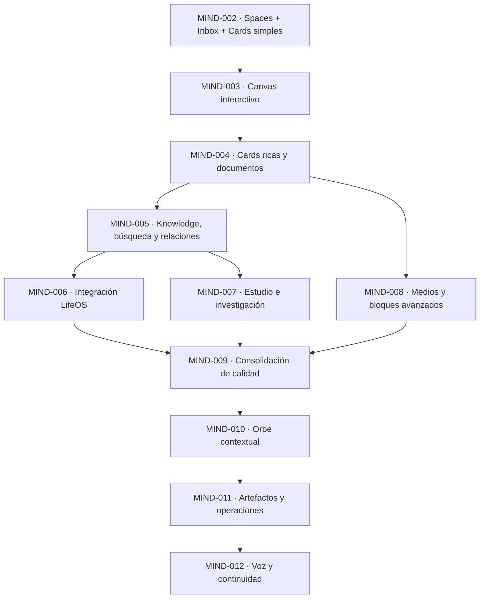

# Mind — Roadmap de producto e implementación

**Versión:** 0.2  
**Fecha:** 22 de noviembre de 2026  
**Rama de planificación:** `planning/mind-001`  
**Estado:** roadmap aprobado como dirección; MIND-002 especificada para inicio.  
**Autoridad:** Product Owner

## 1. Decisión de producto

Mind se construye primero como una aplicación funcional, local-first y útil sin inteligencia artificial.

El orden no es “crear infraestructura de agentes y luego una interfaz”. El orden es:
1. construir un entorno sólido para capturar, pensar, escribir, organizar y trabajar;
2. incorporar tarjetas ricas, documentos, relaciones e integración con LifeOS;
3. habilitar usos de estudio, investigación y proyectos;
4. recién entonces añadir Orbes contextuales, chat y voz como capacidades opcionales.

La referencia funcional es `MIND_PRODUCT_MODEL.md`; los Orbes se rigen por `ORBES_MODEL.md`.

## 2. Modelo mental del producto

`Mind → Inbox / Spaces → Canvases → Cards → Contenido y bloques`

- Inbox: captura transversal.
- Space: contexto flexible.
- Canvas: superficie visual libre.
- Card: objeto visual con contenido propio o referencia a una entidad/canon.
- Bloques: componentes internos de una tarjeta/documento; no son necesariamente nodos independientes.
- Knowledge: contenido canónico reutilizable.
- Relaciones: conexiones visuales y relaciones semánticas.
- Orbe: capa de asistencia futura vinculada a tarjeta/selección/contexto.

## 3. Entregas

### MIND-001 — Diseño y planificación consolidada
**Estado:** diseño de base existente; actualización 0.2 documentada.  
**Resultado:** visión, modelo Orbes, roadmap, cola y SPEC inicial alineados.  
**Regla:** el primer borrador técnico se conserva como auditoría histórica; no se utiliza su orden viejo cuando contradiga este roadmap.

### MIND-002 — Primer núcleo funcional: Spaces, Inbox y Canvas con Cards simples
**Estado:** READY — SPEC en `docs/factory/work/MIND-002/SPEC.md`.  
**Objetivo:** que Mind ya pueda utilizarse para crear contextos, capturar ideas y colocarlas en un lienzo persistente.
**Incluye:**
- entrada Mind en navegación;
- lista y creación de Spaces;
- Inbox transversal único;
- captura rápida que crea contenido canónico;
- creación, apertura, renombrado y archivado de Canvases;
- primera Card de texto/nota dentro del Canvas;
- movimiento y guardado de posición;
- zoom/pan básico, si la solución no compromete estabilidad y accesibilidad;
- exportación/backup/restore de los datos introducidos por Mind;
- estados vacíos, carga, error, éxito y QA responsive.
**No incluye:** documentos por bloques, conexiones semánticas, medios embebidos, Orbes ni voz.

### MIND-003 — Canvas interactivo y relaciones visuales
**Estado:** PLANNING.  
**Objetivo:** completar la experiencia de lienzo.
**Incluye:** conexiones visuales entre Cards, selección múltiple, agrupación/frames si se justifican, resize, orden visual, teclado/touch, operaciones reversibles y undo/redo. Persistencia integrada, no diferida.  
**Criterio:** ninguna interacción espacial puede existir como estado efímero que se pierda al recargar.

### MIND-004 — Cards ricas y documentos
**Estado:** PLANNING.  
**Objetivo:** convertir las tarjetas en contenedores útiles de contenido y trabajo, no solo cajas de texto.
**Incluye por etapas:** títulos, párrafos, encabezados, listas, checklists, enlaces, tablas y campos estructurados/inputs cuando un caso de uso lo justifique; editor inline y vista expandida; autosave y recuperación de borradores.  
**Gate técnico:** definir una única fuente de verdad para contenido nativo, comparando la evolución de Notes frente a un modelo de documentos de Mind. Preservar Notes y evitar duplicación. No decidir almacenamiento de bloques como HTML ejecutable.

### MIND-005 — Knowledge, búsqueda, reutilización y relaciones semánticas
**Estado:** PLANNING.  
**Objetivo:** que el conocimiento sea navegable y reutilizable, independientemente de su ubicación visual.
**Incluye:** biblioteca; búsqueda global y contextual; una misma pieza de contenido representada en varios Canvases; relaciones semánticas tipadas independientes de conexiones visuales; navegación entre contenido y representaciones.

### MIND-006 — Integración con Projects, Tasks y Habits
**Estado:** PLANNING.  
**Objetivo:** conectar Mind con los módulos canónicos de LifeOS.
**Incluye:** Cards vivas de entidades; abrir detalle original; crear tareas desde el contexto de una Card/Canvas/Space mediante servicios existentes; paneles de proyecto que combinen documentos, recursos y tareas sin duplicar datos ni reglas.
**Límite:** no crear réplicas de Tasks/Projects/Habits ni asumir entidades de LifeOS que todavía no existan.

### MIND-007 — Flujos de estudio e investigación
**Estado:** PLANNING.  
**Objetivo:** comprobar que Mind soporta trabajo intelectual real, no solo planificación de proyectos.
**Incluye:** mapas conceptuales/mind maps como disposición opcional del Canvas; fichas de concepto; fuentes y referencias; resúmenes escritos por el usuario; ejercicios; checklists; planes y secuencias de aprendizaje; relaciones entre conceptos.
**Regla:** estos flujos deben funcionar manualmente, sin IA. Las plantillas aceleran la creación, pero no imponen una estructura rígida.

### MIND-008 — Medios, archivos y bloques avanzados
**Estado:** PLANNING.  
**Objetivo:** ampliar el tipo de contenido que se puede incorporar al Canvas.
**Incluye bajo análisis:** imágenes, archivos, enlaces enriquecidos, audio/video y embeds; tablas/formularios u otros componentes interactivos.  
**Condiciones:** local-first; no cargar recursos de terceros automáticamente; embeds remotos solo por acción explícita, con origen visible y controles de privacidad; validar tipos y tamaños de archivo; conservar exportabilidad.

### MIND-009 — Consolidación de calidad y escala
**Estado:** PLANNING; criterios transversales desde MIND-002.  
**Objetivo:** endurecer el producto antes de sumar IA.
**Incluye:** rendimiento de Canvases grandes, accesibilidad completa, navegación por teclado y touch, responsive, undo/redo, recuperación ante fallos, exportación/restauración robustas, integridad de referencias y pruebas de regresión.
**Importante:** esto no aplaza las obligaciones de accesibilidad, backup, persistencia o pruebas; son requisitos mínimos desde cada entrega.

### MIND-010 — Orbe v1: mini-chat contextual por Card
**Estado:** FUTURO — requiere autorización específica de IA y privacidad.  
**Objetivo:** abrir desde una Card un mini-chat compacto con contexto explícito.
**Incluye inicialmente:** solo lectura, preguntas, explicación, resumen, referencias. Sin escritura ni automatización.

### MIND-011 — Orbes: artefactos, propuestas y operaciones aprobadas
**Estado:** FUTURO — requiere aprobación específica.  
**Incluye:** informes, planes, propuestas de tareas/cambios, preview, edición, aprobación y ejecución mediante servicios/APIs tipadas. La ejecución nunca se presume.

### MIND-012 — Orbes: voz y continuidad avanzada
**Estado:** FUTURO — requiere aprobación específica.  
**Incluye:** comandos por voz, transcripción revisable, respuestas habladas opcionales, sesiones persistentes/temporales, contexto ampliable y roles múltiples si se justifican.

## 4. Requisitos transversales no negociables

Desde la primera entrega:
- local-first y funcionamiento esencial sin conexión;
- persistencia real de todo dato/estado de dominio;
- exportación/backup/restauración coherentes cuando se introduzca una tabla o dato nuevo;
- no duplicar entidades canónicas de LifeOS;
- backend como fuente de verdad para reglas de dominio;
- pruebas aisladas de la base personal;
- estados de carga/vacío/error/éxito; preservar borradores ante fallos;
- UX responsive en 1440×900, 768×1024 y 390×844;
- accesibilidad de teclado, foco y lectores de pantalla en la medida verificable;
- no introducir frameworks, dependencias ni servicios remotos sin justificación y aprobación;
- revisar diff, informar pruebas reales y dejar cada entrega en REVIEW.

## 5. Orden y dependencias

MIND-006, MIND-007 y MIND-008 pueden planificarse con cierto solapamiento cuando sus dependencias estén satisfechas, pero deben evitar conflictos sobre el modelo de Cards/documentos.

## 6. Reglas de autorización

- Solo MIND-002 está READY.
- Cada fase posterior requiere SPEC propia y revisión de dependencias antes de comenzar.
- No implementar Orbes, voz ni IA en las fases MIND-002 a MIND-009.
- Los cambios de esquema y contratos API deben justificarse en su SPEC y documentarse en `DATABASE.md`.
- Mimo implementa; un reviewer distinto realiza QA independiente cuando esté disponible; el PO acepta o rechaza.
- Trabajar en un worktree independiente de Evolution. No mover, resetear, stash, sobrescribir ni modificar el trabajo en curso de Evolution.
- La rama de implementación de Mind debe partir del HEAD remoto actual de `product/lifeos-evolution`, verificado al comenzar, no del SHA histórico del borrador MIND-001.
- No fusionar la rama de planificación completa en la rama de producto. Transferir únicamente los documentos Mind aprobados cuando sea necesario.

## 7. Fuera del alcance global de Mind inicial

Colaboración multiusuario, sincronización cloud, acceso remoto, ejecución autónoma, proveedores IA obligatorios, multiagente, memoria semántica global, telemetría y automatizaciones externas.
