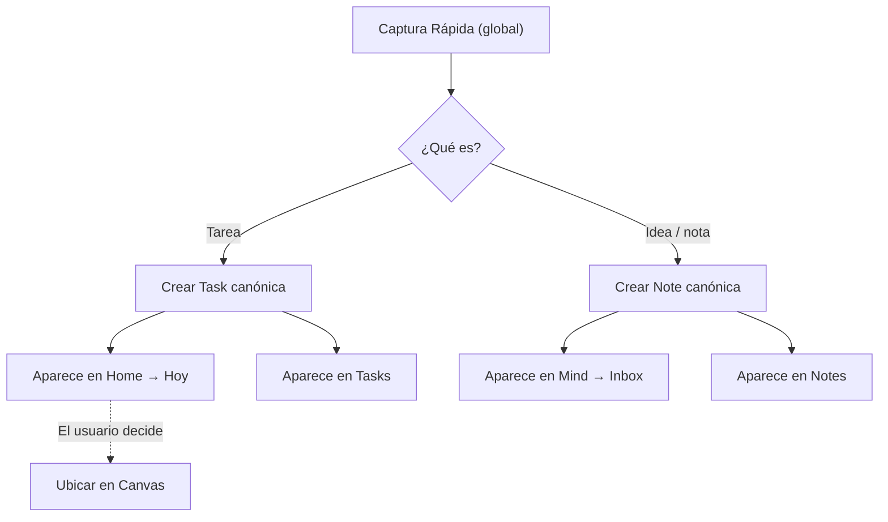
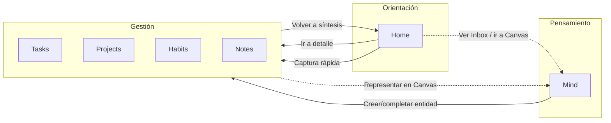
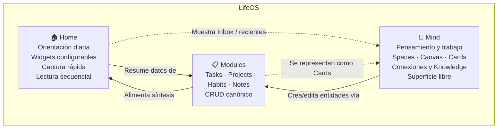

# Home & Mind — Propuesta conceptual de UX

**Autor:** Chief Product Designer / UX Architect  
**Fecha:** 23 de noviembre de 2026  
**Estado:** Propuesta para discusión — no autoriza implementación  
**Documentos consultados:** VISION.md, ARCHITECTURE.md, REQUIREMENTS.md, ROADMAP.md, PRODUCT_MODEL.md, MIND_PRODUCT_MODEL.md, MIND_ROADMAP.md, MIND_IMPLEMENTATION_PLAN_DRAFT.md, ORBES_MODEL.md, AI_AGENT_MODEL.md, UX_DIRECTION.md, UX_INTERACTION_MODEL.md, HOME-001/SPEC.md, MIND-002/SPEC.md, MIND_WORK_QUEUE.md

---

## 1. Diagnóstico: qué dicen los documentos y dónde están las tensiones

### Lo que está resuelto

La documentación tiene una posición clara en varios frentes:

- **Home** es "síntesis y dashboard; no es fuente de verdad" (ARCHITECTURE §5). Responde qué requiere atención, qué puedo hacer hoy, cómo van los proyectos, cómo van los hábitos y cómo capturo algo (UX_DIRECTION §54–62).
- **Mind** es "el entorno visual de pensamiento, conocimiento, trabajo, estudio e investigación" (MIND_PRODUCT_MODEL §1). No es un chat, ni un pizarrón infinito, ni un gestor de tareas duplicado.
- **Ambos** comparten la directriz de no duplicar entidades canónicas (Tasks, Projects, Habits, Notes mantienen su fuente de verdad).
- **El ciclo del producto** es intención → planificación → ejecución → evidencia → aprendizaje → ajuste.

### Lo que no está resuelto

| Tensión | Dónde emerge |
|---|---|
| ¿Qué relación operativa tiene Home con Mind? | Ningún documento define cómo coexisten en la experiencia diaria ni qué ocurre cuando el usuario pasa de uno a otro. |
| ¿Captura rápida de quién? | Home tiene su propia captura rápida (FR-HOME-02). Mind tiene su Inbox con captura transversal. ¿Son redundantes? ¿Convergen? |
| ¿Notes son de Mind o de todos? | Notes existía antes de Mind. Mind reutiliza Notes como contenido canónico (ADR-2). Pero Notes tiene su propio módulo en la navegación. ¿Cuál es la experiencia de "escribir una nota"? |
| ¿Canvas es un paradigma compartible? | La hipótesis dice que Home podría adoptar Canvas. Pero Home está definido como widgets configurables, no como superficie libre. |
| ¿Dónde vive el trabajo de un proyecto? | Projects tiene vista propia. Mind puede representar un proyecto como Space/Canvas con Cards. Home resume proyectos activos. Tres superficies potenciales para la misma intención. |

---

## 2. Qué experiencia debería ofrecer cada módulo

### Home: el pulso operativo personal

> **Metáfora:** la mesa de trabajo al abrir el taller. No es un informe gerencial; es el momento en que el usuario se orienta antes de actuar.

Home responde preguntas inmediatas:

| Pregunta | Lo que Home muestra |
|---|---|
| ¿Qué se me pasó? | Tareas vencidas, sin dramatismo pero con jerarquía clara. |
| ¿Qué tengo hoy? | Tareas relevantes del día, hábitos programados. |
| ¿Cómo va lo importante? | Proyectos activos con ejecución de tareas, no "salud". |
| ¿Qué necesito anotar? | Captura rápida que funcione en dos segundos. |
| ¿Qué dejé pendiente en Mind? | Inbox de Mind: capturas sin clasificar (futuro, cuando exista la integración). |

**Lo que Home NO debe hacer:**
- No sustituir a los módulos. No convertirse en un segundo Tasks ni en un segundo Projects.
- No mostrar métricas sin semántica. Si la cifra no cambia una decisión, no merece espacio.
- No competir con Mind por ser "el lugar de las ideas". Home captura; Mind piensa.
- No convertirse en un dashboard ejecutivo para impresionar. Es una herramienta personal.

### Mind: el taller de pensamiento y trabajo profundo

> **Metáfora:** el escritorio amplio donde se despliegan documentos, se dibujan conexiones y se construyen ideas. No es un archivo; es un espacio vivo.

Mind responde preguntas reflexivas:

| Pregunta | Lo que Mind ofrece |
|---|---|
| ¿Dónde estaba con esta investigación? | Spaces y Canvases que preservan el contexto. |
| ¿Cómo se conectan estas ideas? | Cards y conexiones visuales (y semánticas futuras). |
| ¿Qué sé sobre este tema? | Knowledge: biblioteca de contenido canónico buscable. |
| ¿Qué capturé sin procesar? | Inbox: zona de aterrizaje para lo no clasificado. |
| ¿Cómo planeo este proyecto? | Canvas como espacio de trabajo de un proyecto, integrando tareas y notas sin duplicarlas. |

**Lo que Mind NO debe hacer:**
- No convertirse en un Notion/Obsidian genérico. Mind tiene opinión: es visual, espacial, relacional.
- No replicar la gestión de tareas. Las tareas se crean vía su servicio canónico, no con un segundo CRUD.
- No depender de IA para ser útil. Los Orbes son una mejora, no el producto.
- No ser un pizarrón infinito sin estructura. Los Spaces dan contexto; los Canvases dan forma.

---

## 3. Qué interacciones deberían compartir

### 3.1 Modelo de interacción unificado

Ambos módulos deben sentirse como parte del mismo producto. Propongo un **vocabulario de interacción compartido**:

| Interacción | Comportamiento idéntico |
|---|---|
| **Captura** | Texto → Enter → el sistema crea. Mismo gesto, mismo feedback, mismo respeto por el borrador. |
| **Acción contextual** | Completar tarea, registrar hábito, guardar nota: siempre sobre el objeto, con feedback inmediato. |
| **Revelado progresivo** | Los formularios comienzan cerrados. Los campos opcionales aparecen cuando el usuario los pide. |
| **Estados** | Loading, empty, error, success con los mismos patrones visuales y los mismos componentes. |
| **Confirmación destructiva** | Mismo modal, mismo tono, misma claridad del efecto. |
| **Guardado** | Siempre explícito cuando hay varios campos. Autosave solo para posición/reordenamiento con feedback visible. |
| **Teclado y accesibilidad** | Foco visible, Escape cancela, Enter confirma, alternativa a drag en ambos. |

### 3.2 Captura rápida: la convergencia necesaria

> [!IMPORTANT]
> La captura rápida es el punto de mayor tensión entre Home y Mind. Si no se diseña como un servicio compartido, el usuario tendrá dos buzones, dos entradas, dos experiencias distintas para la misma intención: "quiero anotar esto antes de que se me olvide".

**Propuesta:** una captura rápida unificada, accesible desde cualquier contexto.

- **Desde Home**, la captura crea tareas o notas que alimentan el sistema.
- **Desde Mind**, la captura crea notas que aterrizan en Inbox para clasificar.
- **El mecanismo es uno solo.** La diferencia es el contexto desde el cual se invoca, no la mecánica.

### 3.3 Objetos compartidos, representación distinta

| Objeto canónico | En Home | En Mind |
|---|---|---|
| Task | Fila en lista de Hoy/Atención, con acción de completar | Card en Canvas, referencia al servicio de Tasks |
| Project | Tarjeta compacta con ejecución de tareas | Space o Canvas de trabajo, con documentación y relaciones |
| Habit | Estado del día con acción directa | Card referenciando hábito (integración MIND-006) |
| Note | Acceso vía captura rápida | Contenido canónico, representable en múltiples Canvases |

---

## 4. Qué diferencias deberían conservar

### Diferencias estructurales que son virtud, no accidente

| Dimensión | Home | Mind |
|---|---|---|
| **Temporalidad** | Hoy, esta semana, lo urgente. Horizonte inmediato. | Atemporal. El Canvas de un proyecto puede vivir meses. |
| **Espacio** | Layout fijo con widgets configurables. Densidad funcional. | Superficie libre. El usuario decide la organización espacial. |
| **Interacción principal** | Leer, decidir, actuar (completar, registrar, capturar). | Explorar, conectar, pensar, escribir, reorganizar. |
| **Profundidad** | Resumen y navegación a módulos. No sustituye al módulo. | Profundidad propia. El Canvas ES el lugar de trabajo. |
| **Personalización** | Qué widgets ver y en qué orden. | Qué Spaces crear, qué Cards colocar, cómo conectarlas. |
| **Frecuencia** | Varias veces al día, visitas breves. | Sesiones más largas, contexto sostenido. |
| **Lectura** | Vertical, secuencial, escaneable. | Espacial, no-lineal, exploratorio. |

### El error a evitar: unificar lo que debe ser diferente

Forzar Canvas en Home destruiría la velocidad de la lectura vertical. Forzar widgets en Mind destruiría la libertad espacial. **La unidad no viene de compartir la forma, sino de compartir el vocabulario, los principios y los datos.**

---

## 5. Cómo evitar que Home sea un dashboard administrativo

> [!WARNING]
> Home tiene una gravedad natural hacia lo administrativo: agregar métricas, agregar gráficos, agregar totales. Cada métrica nueva reduce la señal y aumenta el ruido.

### Principios anti-dashboard

1. **La pregunta antes que la métrica.** Si no puedo formular qué pregunta responde un dato, ese dato no va en Home.

2. **Acción, no observación.** Home no es para mirar gráficos; es para decidir qué hacer ahora. Si un elemento no conduce a una acción o decisión, es decoración.

3. **Cero métricas sin denominador claro.** "23 tareas completadas" sin contexto no es información. "3 de 5 tareas de hoy completadas" lo es.

4. **El estado vacío es informativo, no vergonzoso.** "Sin tareas urgentes" no es un fracaso; es información útil. No llenar el vacío con gráficos o mensajes motivacionales.

5. **Home respeta los módulos.** No reconstruir una mini-versión de Tasks dentro de Home. Home muestra, resume, invita a actuar; los módulos son el lugar de trabajo.

6. **Progresión visible, no gamificación.** Las barras de progreso miden ejecución de tareas, no "puntaje de productividad". Las rachas de hábitos son registro, no competencia.

### Test de diseño para Home

Antes de agregar un elemento a Home, responder:
- ¿Qué pregunta operativa responde?
- ¿El usuario puede actuar sobre esta información?
- ¿Este dato ya está en un módulo? ¿El resumen aporta algo que la navegación directa no dé?
- ¿Funciona sin Internet, sin IA, con cero datos?

---

## 6. Cómo evitar que Mind sea una aplicación de notas

> [!WARNING]
> Mind tiene una gravedad natural hacia el texto: si el Canvas se usa solo para escribir notas organizadas en carpetas (Spaces), Mind se convierte en un Notion sin equipo y sin los 10 años de producto que Notion tiene encima.

### Principios anti-notes-app

1. **El Canvas es el diferenciador.** Si el usuario solo escribe texto, puede usar Notes. Mind existe para cuando necesita ver las relaciones, la disposición espacial, el mapa del problema.

2. **Las conexiones son ciudadanos de primera.** Desde MIND-003 en adelante, dibujar relaciones entre Cards es tan natural como moverlas. La estructura emerge del uso, no de una jerarquía impuesta.

3. **Los Spaces son contextos, no carpetas.** Un Space de "Research" no es una carpeta donde van archivos; es un entorno que contiene Canvases de investigación, una biblioteca de fuentes y un contexto visual de trabajo.

4. **Mind integra, no aísla.** Un Canvas de proyecto puede mostrar Cards que son tareas reales, notas documentales y nodos visuales de planificación. Mind gana valor cuando conecta dominios, no cuando los encierra.

5. **El contenido tiene identidad propia.** Una nota existe en Knowledge independientemente de dónde se muestra. El Canvas organiza; Knowledge preserva. Esta separación es lo que permite reutilizar sin duplicar.

6. **La creación de Cards invita a pensar, no solo a escribir.** Al crear en Canvas, la pregunta implícita es "¿qué es esto y cómo se relaciona con lo demás?", no solo "¿qué quiero anotar?".

### Test de diseño para Mind

Antes de diseñar una interacción en Mind, responder:
- ¿Esto requiere la superficie espacial del Canvas, o alcanza con una lista?
- ¿El usuario gana algo al ver este objeto en contexto con otros?
- ¿Estoy creando un segundo editor de notas o un espacio de trabajo visual?
- ¿La información se puede buscar, reutilizar y conectar, o queda enterrada en un Canvas?

---

## 7. Modelo de interacción unificado

### 7.1 Los tres modos del producto

| Modo | Módulos | Experiencia | Verbo dominante |
|---|---|---|---|
| **Orientación** | Home | ¿Qué necesita mi atención? | Leer, decidir |
| **Gestión** | Tasks, Projects, Habits, Notes | Crear, editar, completar, registrar | Actuar |
| **Pensamiento** | Mind | Explorar, conectar, planificar, aprender | Construir |

### 7.2 Principios del modelo unificado

1. **Un dato, una fuente, muchas vistas.** Una tarea vive en Tasks. Home la resume. Mind la representa. Ninguna la duplica.

2. **La navegación refleja la intención, no la jerarquía.** El usuario no piensa "voy al módulo de tareas"; piensa "quiero completar esa tarea que vi en Home" o "quiero agregar esta tarea al Canvas de mi proyecto".

3. **Las transiciones preservan contexto.** Si hago clic en un proyecto desde Home, llego al proyecto. Si hago clic en una Card de proyecto en Mind, llego al mismo proyecto. El destino es el mismo; el origen varía.

4. **Captura sin fricción desde cualquier punto.** Crear una tarea o nota desde Home, desde Mind, desde un Canvas, desde un proyecto → el mecanismo es el mismo servicio canónico con contexto opcional.

5. **Los módulos de gestión son la interfaz CRUD; Home y Mind son experiencias de orden superior.** Tasks, Projects, Habits y Notes son los operadores. Home es el resumen. Mind es el taller.

---

## 8. Sobre la hipótesis del Canvas compartido

### Cuestionamiento

> *Hipótesis: "Ambos podrían compartir el paradigma de Canvas."*

**Mi evaluación: no para Home, sí para Mind, y potencialmente para Projects.**

#### Canvas en Home: no recomendado

Home es una experiencia de **lectura rápida, decisión y acción inmediata**. Canvas es una experiencia de **exploración espacial, disposición libre y construcción progresiva**. Son modos cognitivos opuestos.

Un Canvas en Home obligaría al usuario a:
- organizar visualmente su resumen diario (trabajo innecesario);
- perder la lectura secuencial optimizada para escaneo;
- gestionar posiciones de widgets en un espacio libre (más complejo que reordenar una lista).

Lo que Home necesita no es libertad espacial, sino **jerarquía intencional**: primero lo urgente, luego lo del día, luego lo de fondo. Eso se resuelve con layout predefinido y orden configurable.

#### Canvas en Mind: sí, es el paradigma central

Ya está resuelto. Canvas es el corazón de Mind.

#### Canvas como workspace de proyecto: potencial futuro

Cuando exista MIND-006 (Integración con Projects, Tasks y Habits), un Canvas podrá funcionar como **espacio de trabajo de un proyecto**: documentación, decisiones, tareas, dependencias y contexto, todo visible y conectado. Esto es más poderoso que agregar Canvas a Home: es usar Mind como el lugar donde se trabaja un proyecto en profundidad, con Home como el resumen rápido y Projects como el CRUD canónico.

---

## 9. Home futuro: puentes a Mind sin ser Canvas

Aunque Home no adopte Canvas, puede beneficiarse de la existencia de Mind:

### 9.1 Inbox como presencia en Home

Cuando Mind esté integrado, Home puede mostrar un indicador discreto:

> **Mind Inbox** · 4 ideas sin clasificar → Ir a Inbox

Esto conecta ambos mundos sin duplicar la experiencia.

### 9.2 "Continuar trabajando"

Home podría mostrar los Canvases/Spaces más recientes del usuario:

> **Continuar en Mind** · Canvas "Investigación Q4" (hace 2h) → Abrir

Esto respeta que Mind es un espacio de trabajo sostenido y Home es el punto de retorno.

### 9.3 Captura que alimenta ambos

La captura rápida de Home para notas podría ofrecer un destino explícito:

> Crear nota → ¿Enviar a Mind Inbox? [Sí / Solo Notes]

Esto evita dos capturas y conecta flujos sin forzar al usuario a abrir Mind.

---

## 10. Decisiones pendientes

> [!CAUTION]
> Las siguientes decisiones no pueden resolverse solo con diseño; requieren posición del PO y, en algunos casos, impacto en datos/arquitectura.

### D1 — ¿La captura rápida converge o se mantiene dual?

| Opción | Consecuencia |
|---|---|
| **A: Convergencia** — un mecanismo de captura con contexto | Coherente, pero requiere diseñar la experiencia de "¿esto es tarea o nota?" y "¿va a Mind Inbox o solo a Notes?". Aplazar hasta MIND-006 o posterior. |
| **B: Dual pero conectada** — Home captura tareas/notas, Mind captura al Inbox | Más simple ahora. Las notas capturadas en Home no van a Inbox automáticamente. El usuario puede moverlas manualmente a Mind. |
| **Recomendación** | B ahora, converger hacia A cuando Mind esté estable y la integración (MIND-006) exista. |

### D2 — ¿Notes como módulo de navegación separado tiene futuro?

A medida que Mind crezca, Notes pierde sentido como módulo independiente: su contenido es el Knowledge de Mind. ¿Notes se mantiene como acceso directo a la biblioteca? ¿Se fusiona con Mind Knowledge? ¿Se convierte en una vista de Mind?

| Opción | Consecuencia |
|---|---|
| **A: Notes permanece** | Tres lugares para notas: Notes, Home captura, Mind Knowledge. Confuso a largo plazo. |
| **B: Notes se convierte en vista de Knowledge** | Una fuente de verdad con múltiples accesos. Requiere migración UX (no de datos). |
| **C: Notes se redirige a Mind** | El módulo Notes desaparece de la navegación; el usuario accede al contenido desde Mind. |
| **Recomendación** | A ahora (no romper lo que funciona). Diseñar B como destino cuando Mind alcance MIND-005 (Knowledge y búsqueda). |

### D3 — ¿Qué información de Mind aparece en Home?

Opciones, no mutuamente excluyentes, todas para después de MIND-006:

- [ ] Contador de Inbox (capturas sin clasificar)
- [ ] Canvases/Spaces recientes ("Continuar trabajando")
- [ ] Nada: Home y Mind son experiencias independientes

### D4 — ¿El proyecto como "objeto vivo" tiene un lugar de trabajo?

Un proyecto actualmente tiene: una vista en Projects (CRUD), un resumen en Home y potencialmente un Canvas en Mind. ¿Cuál es la experiencia primaria de "trabajar en un proyecto"?

| Opción | Consecuencia |
|---|---|
| **A: Projects es primario** | Mind complementa, pero la gestión operativa vive en Projects. Consistente con el MVP. |
| **B: Mind Canvas es primario** | El proyecto se gestiona visualmente desde Mind; Projects es el motor CRUD subyacente. Requiere MIND-006 completo. |
| **C: Depende del usuario** | Ambos son primeros ciudadanos; el usuario elige. Pero necesita diseño para evitar confusión. |
| **Recomendación** | A ahora, evaluar C cuando Mind sea estable. No forzar B: algunos proyectos son operativos y no necesitan un Canvas. |

### D5 — ¿Widgets de Home evolucionan?

Los widgets actuales (upcoming_tasks, active_projects, quick_add_task, quick_add_note, habits_today, habits_week) ¿son una lista cerrada o un catálogo extensible?

Si extensible, ¿Mind puede contribuir widgets propios al Home? (Inbox count, recent Canvases). Esto requiere definir un contrato de widget.

---

## 11. Principios de diseño propuestos

### Para Home

1. **Orientación antes que información.** Home responde "qué hago ahora", no "cuántas cosas tengo".
2. **Tres segundos.** Si en tres segundos el usuario no identifica qué es urgente, el diseño falló.
3. **Sin scroll para lo crítico.** Lo urgente está arriba. No enterrar vencidas debajo de un gráfico.
4. **Captura en dos pasos.** Título → guardar. Todo lo demás es opcional.
5. **Respetar el espacio vacío.** Un día sin urgencias es información, no un error de diseño.

### Para Mind

1. **El Canvas no es decoración.** Si una idea no gana nada al estar en un Canvas, no forzarla ahí.
2. **Conexiones primero.** El valor de Mind no es "notas bonitas"; es ver cómo se relacionan.
3. **Profundidad sin aislamiento.** Un Canvas que no se conecta con nada no es un taller; es un cajón.
4. **Persistencia total.** Si el usuario puso algo en un Canvas, está ahí mañana. Sin excepciones.
5. **Accesibilidad del espacio.** Si no se puede navegar con teclado, no existe para todos.

### Compartidos

1. **Un dato, una fuente.** Nunca duplicar una entidad para mostrarla en otro módulo.
2. **Consistencia de patrones.** El mismo gesto (Escape, Enter, Guardar/Cancelar) significa lo mismo en todas partes.
3. **Error honesto.** Un fallo de red no es "sin datos". Un módulo vacío no es "todo bien".
4. **El usuario decide.** No auto-mover, auto-clasificar ni auto-eliminar contenido.
5. **Local-first siempre.** Toda interacción funciona sin Internet.

---

## 12. Resumen ejecutivo

| Aspecto | Home | Mind |
|---|---|---|
| Pregunta central | ¿Qué necesita mi atención? | ¿Cómo se conecta esto con lo demás? |
| Superficie | Widgets en layout fijo | Canvas en superficie libre |
| Profundidad | Resumen → navegar a módulo | Espacio de trabajo propio |
| Tempo | Visita breve, varias al día | Sesión sostenida |
| Personalización | Visibilidad y orden de widgets | Spaces, Canvases, Cards, posiciones |
| Captura | Tarea/nota rápida | Idea → Inbox → clasificar → Canvas |
| Canvas compartido | **No recomendado** | **Es el paradigma central** |
| Dato compartido | Sí: mismas entidades, distinta presentación | Sí: referencia sin duplicar |

**Lo que une Home y Mind no es la forma; es la información, los principios y el vocabulario de interacción.** Son dos experiencias complementarias del mismo sistema operativo personal.

---

> [!NOTE]
> Esta propuesta es un marco de decisión, no una especificación de implementación. Las decisiones pendientes (D1–D5) requieren posición del PO antes de que afecten roadmap o código. Ninguna de estas ideas modifica las entregas en curso (Fase 9.1 ni MIND-002); son dirección para las fases de integración posterior.